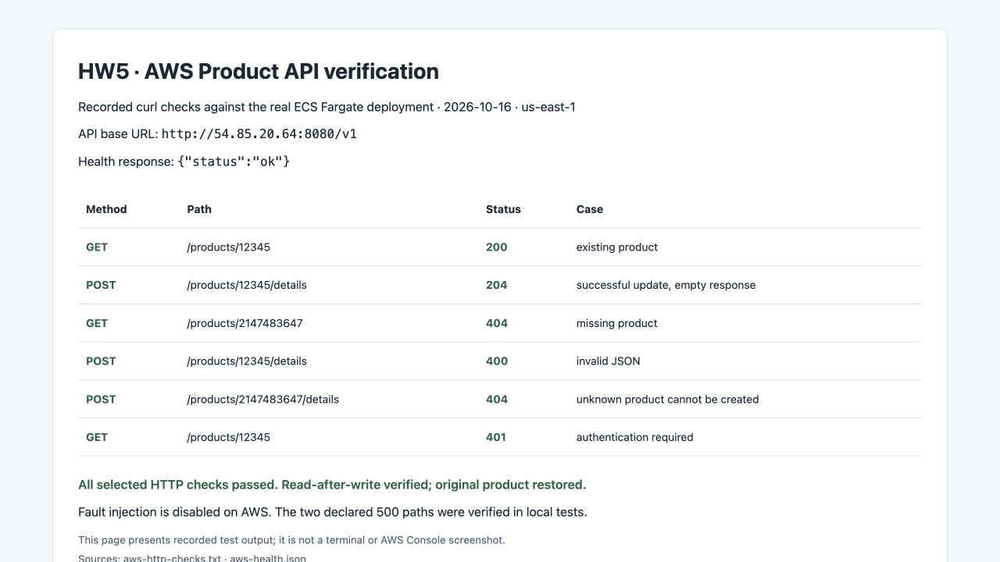
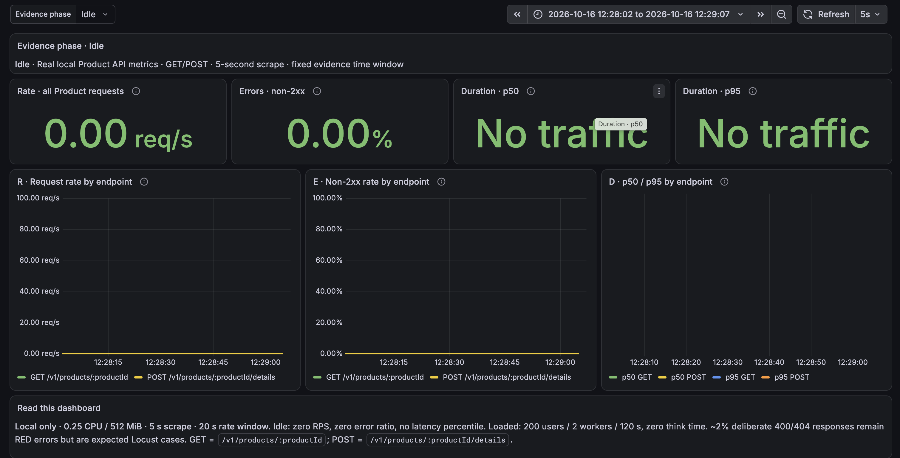
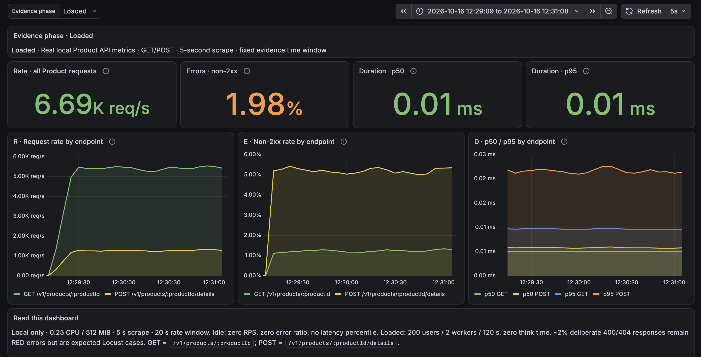
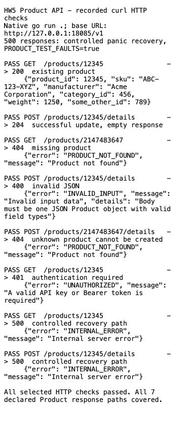
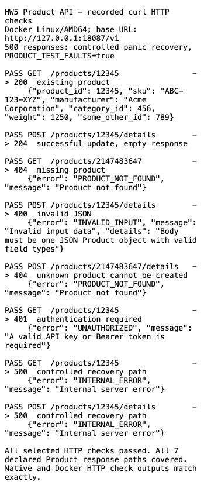

# Homework 5 Product API

This stage implements the Product GET and POST operations from [api.yaml](api.yaml), using Gin and an in-memory store. Native Go checks, race tests, Docker runtime checks, a real Terraform deployment to ECS Fargate, and initial Locust comparisons/stress testing are complete. Local RED instrumentation, Prometheus/Grafana provisioning and a paired idle/load experiment are verified. Both original browser screenshots supplied by the user are saved and visually checked in [the observability guide](observability/README.md#evidence-and-screenshots).

## Code and contract

| File | Purpose |
| --- | --- |
| [src/product-service.go](src/product-service.go) | Models, validation, synchronized store, authentication, handlers and request logs |
| [src/product-service_test.go](src/product-service_test.go) | Contract boundaries, error handling, authentication and concurrent access tests |
| [src/metrics.go](src/metrics.go) | Per-router Prometheus RED counters, duration histogram and scrape handler |
| [src/metrics_test.go](src/metrics_test.go) | Final status, histogram counts, cardinality, scrape exclusion and registry isolation tests |
| [src/Dockerfile](src/Dockerfile) | Multi-stage Go build with a nonroot distroless runtime |
| [scripts/check_api.py](scripts/check_api.py) | Drives curl requests and checks HTTP status, JSON fields and read-after-write behavior |
| [evidence/native-http-checks.txt](evidence/native-http-checks.txt) | Recorded responses from the native server |
| [evidence/native-server.jsonl](evidence/native-server.jsonl) | Structured logs extracted from the native run |
| [evidence/native-server.raw.log](evidence/native-server.raw.log) | Complete native output, including the deliberate process shutdown message |
| [evidence/docker-http-checks.txt](evidence/docker-http-checks.txt) | The same checks against the Linux/AMD64 container |
| [evidence/docker-server.jsonl](evidence/docker-server.jsonl) | Request logs from the container test |
| [evidence/docker-build.txt](evidence/docker-build.txt) | Successful Docker build output |
| [evidence/docker-image.txt](evidence/docker-image.txt) | Image identity, architecture, nonroot user and size |

`/v1` is the base path from the specification's server URLs. Unversioned `/products/...` aliases use the same handlers and store for convenient local testing.

| Method and path | Declared responses |
| --- | --- |
| `GET /v1/products/{productId}` | 200 Product JSON, 404 Error JSON, 500 Error JSON |
| `POST /v1/products/{productId}/details` | 204 with no body, 400 Error JSON, 404 Error JSON, 500 Error JSON |

Every Product field is required. Numeric values are int32. `product_id`, `category_id` and `some_other_id` must be at least 1. `weight` is grams and may be zero. `sku` is 1-100 Unicode characters, and `manufacturer` is 1-200 characters. Missing/null fields, incorrect JSON types and int32 overflow are rejected. Extra JSON properties are accepted because the schema does not prohibit them.

Errors contain `error` and `message`, with optional `details`. Successful POST returns an empty 204 response; GET returns the complete Product object.

## Interpretation of unspecified behavior

- The spec describes adding/updating details and a POST 404, but provides no product-creation operation. Each fresh process starts with IDs **1, 2 and 12345**. POST replaces the details of an existing product; an unknown ID returns 404. Restarting resets the store. This bootstrap assumption should be confirmed if the course provides a different rule.
- The URL ID must match the body's `product_id`; a mismatch returns 400. SKU uniqueness is enforced across existing products, interpreting the description "unique product code" literally; duplicate SKU updates return 400 without changing data. SKU comparisons are case sensitive.
- An invalid GET ID returns 404 because that operation lists no 400. An invalid POST ID returns 400. POST validates the body before looking up the product.
- The global security requirement allows API key **or** Bearer authentication even though the Product response lists omit 401. Missing/invalid credentials therefore return 401 using the same Error shape.
- No issuer or key-discovery rules are supplied for BearerAuth. For local testing, optional Bearer tokens are HS256 JWTs signed with `PRODUCT_JWT_SECRET`, with a required future `exp` and an optional `nbf`. This local shared-secret convention is not an external identity-provider integration. API-key authentication is sufficient for the examples below.
- POST accepts `application/json` with a maximum body size of 1 MiB. Invalid content type, oversized bodies, and trailing JSON values return 400. `/health` is an additional unauthenticated readiness endpoint.

## Terraform deployment

See [the Terraform guide](terraform/README.md) for credentials, plan/apply steps, endpoint discovery, API checks, and cleanup. The infrastructure retains the assignment starter's network/ECR/logging/ECS modules and deploys one Product task with fault injection disabled.

The deployment on 2026-10-16 used `us-east-1`, one Linux/X86_64 task, 0.25 vCPU and 512 MiB. Terraform created eight managed resources (six AWS resources and two Docker image/publication resources). ECS reported the deployment `COMPLETED`, with one running task and zero pending. A subsequent [Terraform plan found no changes](evidence/aws-no-changes.txt). The public API at verification time was `http://54.85.20.64:8080/v1`; this address changes if the task is replaced, and port 8080 is restricted to the configured client IPv4 /32. Use `python3 scripts/ecs_endpoint.py` to resolve the current address.

The [cloud HTTP checks](evidence/aws-http-checks.txt) passed, including update/read-after-write, validation, 404, 401, and restoring the original product. The [health response](evidence/aws-health.json), [ECS status](evidence/aws-service-status.json), [Terraform apply output](evidence/aws-apply.txt), and [CloudWatch JSON request logs](evidence/aws-server.jsonl) record the real run. The two declared 500 paths remain local demonstrations; the AWS task has fault injection disabled.



This screenshot presents recorded test results in a browser. The [live health screenshot](screenshots/aws-health.jpg) separately captures the actual AWS `/health` response.

## Locust tests and Chrome screenshots

See [the Locust guide](locust/README.md) for the shared Product workload, Docker Compose commands, exact run settings, CSV results, resource evidence and actual Statistics/Charts screenshots from Google Chrome, following the HW3 format. The two 50-user baselines had no failures. The 1,000-user test observed 0.51% transport failures and p95 of 3.6 seconds; server CPU was not saturated in the collected CloudWatch samples, so these results do not establish its CPU capacity limit.


## Mock interview and design answers

Use [the mock interview guide](interview.md) for an opening answer, a ten-minute demonstration order and short English answers with Chinese explanations. [Design and tradeoffs](design.md) covers the complete design discussion and the limits of the measured results.

I expect catalog reads to outnumber updates, so the workload assumes 80% GET and 20% POST. A map gives expected constant-time ID lookup; an RWMutex coordinates concurrent goroutines, and a second index enforces SKU uniqueness. This state belongs to one process and disappears on restart, so multiple mutable API replicas require shared storage first.

The observed HttpUser/FastHttpUser baselines achieved 142.54/60.99 RPS, respectively. FastHttpUser reduces generator CPU overhead; it does not guarantee shorter individual requests. Repeated alternating runs would be needed to explain the observed difference. The 1000-user stress run reached p95 3.6 seconds with 0.5105% transport failures, demonstrating degradation in the tested path without identifying its precise bottleneck. See [the measured comparison and explanation](design.md#client-comparison-and-stress-results).

For the full online store, I would place replaceable API tasks behind a load balancer, use shared durable Product/Cart/Order/Inventory storage, cache catalog reads, reserve stock atomically and persist checkout/payment identities for safe retries. A durable order state plus transactional outbox supports asynchronous fulfillment without assuming database writes and queue sends succeed together. These are [design proposals](design.md#scalable-store-proposal), not implemented cart or payment endpoints.

Terraform is declarative: I describe the desired resources and references, and Terraform plans changes using providers, state and dependencies. This makes deployments reviewable and repeatable, but apply can still fail after completing some resources. The [Terraform discussion](design.md#terraform-declarative-configuration) explains recovery and the contrast with imperative scripts.

## Local observability evidence

Both [idle](screenshots/grafana-red-idle.png) and [loaded](screenshots/grafana-red-loaded.png) dashboard screenshots show the same verified experiment. Idle has 0 RPS, 0% errors and no latency observations. The loaded screenshot shows 6.69k RPS and 1.98% non-2xx, including deliberately expected 400/404 responses. Complete commands, metric definitions, timing boundaries and reconciliation are in [the observability guide](observability/README.md#evidence-and-screenshots).





These four records are copied from [the same-run request log excerpt](evidence/observability/red-20261016-verified-server-excerpt.jsonl):

```jsonl
{"time": "2026-10-16T19:29:08.699030132Z", "level": "INFO", "msg": "request", "method": "GET", "endpoint": "/v1/products/:productId", "status": 200, "duration_ms": 0.043}
{"time": "2026-10-16T19:29:08.702754132Z", "level": "INFO", "msg": "request", "method": "POST", "endpoint": "/v1/products/:productId/details", "status": 204, "duration_ms": 0.019}
{"time": "2026-10-16T19:29:08.713345674Z", "level": "INFO", "msg": "request", "method": "GET", "endpoint": "/v1/products/:productId", "status": 404, "duration_ms": 0.004}
{"time": "2026-10-16T19:29:08.713563424Z", "level": "INFO", "msg": "request", "method": "POST", "endpoint": "/v1/products/:productId/details", "status": 400, "duration_ms": 0.005}
```

I use dashboards to identify changes in rate, error percentage and latency over time. I use request logs to inspect individual failures or slow requests and reconstruct what happened after an incident.

## Assignment evidence checklist

| Requirement | Implementation or evidence |
| --- | --- |
| Product contract and every declared response | [API schema](api.yaml), [Go handlers](src/product-service.go), [curl examples](#trigger-every-declared-response), native and Docker check records |
| Dockerfile and local execution | [Dockerfile](src/Dockerfile), [Docker checks](evidence/docker-http-checks.txt), [race tests](evidence/observability/go-race-tests.txt) |
| Adapted starter and ECS deployment | [Terraform guide](terraform/README.md), [successful apply](evidence/aws-apply.txt), [cloud HTTP checks](evidence/aws-http-checks.txt) |
| Fork of the assignment starter | [bsyc26/CS6650_2b_demo](https://github.com/bsyc26/CS6650_2b_demo), [verified parent metadata](evidence/github-starter-fork.json), [browser screenshot](screenshots/github-starter-fork.jpg) |
| Reproduce deployment on another machine | [Prerequisites and deployment commands](terraform/README.md#local-prerequisites), [endpoint discovery](terraform/README.md#find-and-verify-the-api) |
| HttpUser versus FastHttpUser and stress | [Locust results and actual browser screenshots](locust/README.md), [analysis](design.md#client-comparison-and-stress-results) |
| Local RED dashboard and request logs | [Idle and loaded screenshots with same-run logs](observability/README.md#evidence-and-screenshots), [metrics code](src/metrics.go) |
| Tradeoffs, declarative Terraform and scalable store | [Design answers](design.md), [mock interview](interview.md) |
| Sensitive and generated files excluded | [.gitignore](.gitignore); provider lock file retained |

## Submission and lifecycle status

The required starter fork is [bsyc26/CS6650_2b_demo](https://github.com/bsyc26/CS6650_2b_demo), created on 2026-10-16. The GitHub page and [repository metadata](evidence/github-starter-fork.json) confirm that its parent is `RuidiH/CS6650_2b_demo` and its default branch is `master`. The adapted code's upstream source commit is recorded in [the Terraform guide](terraform/README.md).

This fork contains the HW5 Product implementation, infrastructure, documentation and recorded evidence. Clone `git@github.com:bsyc26/CS6650_2b_demo.git` and run the commands below from the repository root. Piazza posting and course submission are separate actions that have not been performed.

[Publication checks](evidence/publication/verification.json) passed in this fork checkout: [Go race tests](evidence/publication/go-race-tests.txt) with 88.3% coverage, [Terraform validation](evidence/publication/terraform-validate.txt) and [four mock tests](evidence/publication/terraform-tests.txt). Local documentation links and screenshot hashes were checked, and configured credentials plus private runtime artifacts were excluded from the submission.

The saved AWS results describe the earlier deployed image; local metrics changes have not been redeployed to AWS. Keep the running services available for the demonstration, then use [Terraform cleanup](terraform/README.md#state-and-cleanup) and stop local Compose services when finished. Successful destruction has not yet been recorded.

## Run with Go

Prerequisites: Go 1.26.8 or newer, curl, and Python 3.9 or newer for the HTTP-check script. From the repository root:

```bash
# First run only: create a local, ignored environment file.
cp .env.example .env
set -a
. ./.env
set +a
cd src
go run .
```

The default address is `0.0.0.0:8080`; set `PORT` to use another port. `PRODUCT_API_KEY` or `PRODUCT_JWT_SECRET` must be configured. The example API key is public development data, not a credential to reuse in AWS.

In another terminal, from the repository root:

```bash
export PRODUCT_API_KEY=hw5-local-key
python3 scripts/check_api.py
```

This checks normal operation, validation failures, 404s, 401, and restores the modified product. Each product update uses the store's write lock across existence checking, SKU uniqueness checking, and replacement. Reads copy a product under a read lock. The store is safe for concurrent requests within one process; different ECS tasks would still have independent data.

## Trigger every declared response

Use the native server or the container with `PRODUCT_TEST_FAULTS=true` for this local demonstration. The normal configuration defaults to false and ignores the test header. Stop the regular server first, then start the demonstration server:

```bash
cd src
PRODUCT_API_KEY=hw5-local-key PRODUCT_TEST_FAULTS=true go run .
```

Run the complete curl-based check from the repository root:

```bash
PRODUCT_API_KEY=hw5-local-key python3 scripts/check_api.py --faults
```

Individual examples below assume that demonstration server is running. The `curl -i` output shows HTTP status and headers as well as the body.

```bash
BASE=http://127.0.0.1:8080/v1
KEY=hw5-local-key
BODY='{"product_id":12345,"sku":"ABC-123-XYZ","manufacturer":"Acme Corporation","category_id":456,"weight":0,"some_other_id":789}'

# GET 200: existing seeded product.
curl -i -H "X-API-Key: $KEY" "$BASE/products/12345"

# GET 404: unknown positive int32 ID.
curl -i -H "X-API-Key: $KEY" "$BASE/products/2147483647"

# POST 204: valid details, with zero weight, and no response body.
curl -i -X POST -H "X-API-Key: $KEY" -H 'Content-Type: application/json' \
  --data "$BODY" "$BASE/products/12345/details"

# POST 400: required Product fields are missing.
curl -i -X POST -H "X-API-Key: $KEY" -H 'Content-Type: application/json' \
  --data '{}' "$BASE/products/12345/details"

# POST 404: valid body for a product that does not exist.
curl -i -X POST -H "X-API-Key: $KEY" -H 'Content-Type: application/json' \
  --data '{"product_id":2147483647,"sku":"MISSING","manufacturer":"Acme","category_id":1,"weight":0,"some_other_id":1}' \
  "$BASE/products/2147483647/details"

# GET 500: explicitly enabled local recovery demonstration.
curl -i -H "X-API-Key: $KEY" -H 'X-HW5-Test-Failure: panic' \
  "$BASE/products/12345"

# POST 500: explicitly enabled local recovery demonstration.
curl -i -X POST -H "X-API-Key: $KEY" -H 'Content-Type: application/json' \
  -H 'X-HW5-Test-Failure: panic' --data "$BODY" "$BASE/products/12345/details"

# Global authentication requirement: 401 without a valid credential.
curl -i "$BASE/products/12345"
```

The 500 examples deliberately exercise panic recovery; they are not naturally occurring storage outages. Unit tests separately inject failing store operations to verify both handlers' internal-error branches. Errors never return the internal failure text or stack trace.

## Build and run the container

From the repository root with Docker running:

```bash
docker build --platform linux/amd64 -t hw5-product:local src
docker run --rm --name hw5-product -p 127.0.0.1:8080:8080 \
  --env-file .env -e PRODUCT_TEST_FAULTS=true hw5-product:local
```

Then run the same `check_api.py --faults` command from a second terminal. Stop the native server before publishing the same port, or publish container port 8080 on another host port and pass `--base-url http://127.0.0.1:8081/v1` to the script. Stop the container after collecting evidence. For the normal configuration, omit the `PRODUCT_TEST_FAULTS=true` override.

The builder compiles a static binary for the selected Docker platform. The final image contains the binary without the Go toolchain and runs as nonroot.

## Tests and current evidence

```bash
cd src
go test -race -cover ./...
```

Native verification used Go 1.26.8 on macOS ARM64. All tests passed under the race detector, with 85.8% statement coverage. The concurrency case performs 640 updates and 640 reads. Cross-compilation also produced a statically linked Linux/AMD64 binary. The live curl check covered all seven declared method/status paths, checked persistence of a successful update, verified input failures, and restored the initial product. The recorded native run used port 18085 and enabled the controlled fault switch.



The screenshot shows the recorded curl output in a browser, rather than a terminal window. The full responses and request logs are linked above.

The same curl checks passed against the Linux/AMD64 container published on loopback port 18087. Its full HTTP-check output matches the native run exactly. The final image runs as user 65532 and is 25,692,280 bytes according to Docker inspection. A second container run omitted the fault switch: [normal checks](evidence/docker-normal-http-checks.txt) passed, and [sending the test header still returned 200](evidence/docker-fault-disabled.txt). The temporary native servers and test containers were stopped after recording evidence; the image remains available locally.



One JSON line per request records `method`, route-template `endpoint`, `status`, and `duration_ms`, without request credentials or bodies. CloudWatch also received these logs during AWS verification and the Locust runs. The current local image also exposes Prometheus RED metrics and serves the [local dashboard workflow](observability/README.md). Its dashboard metrics and JSON log excerpt come from the same local experiment; the instrumentation has not yet been redeployed to AWS.
