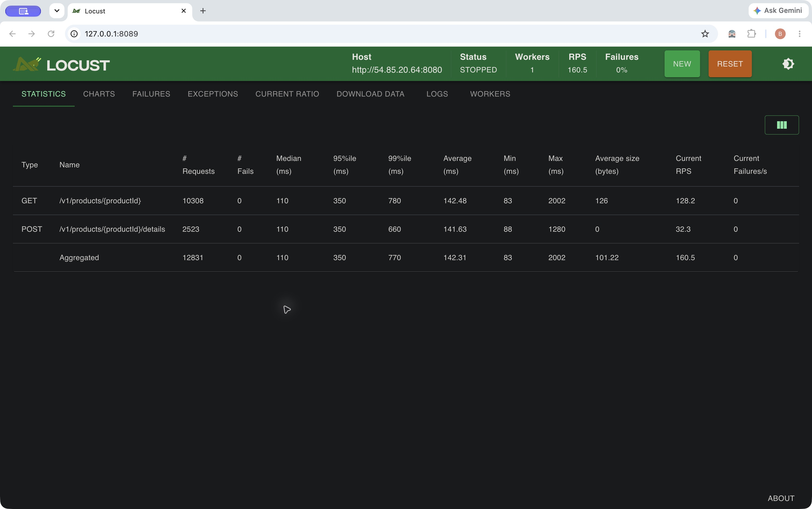
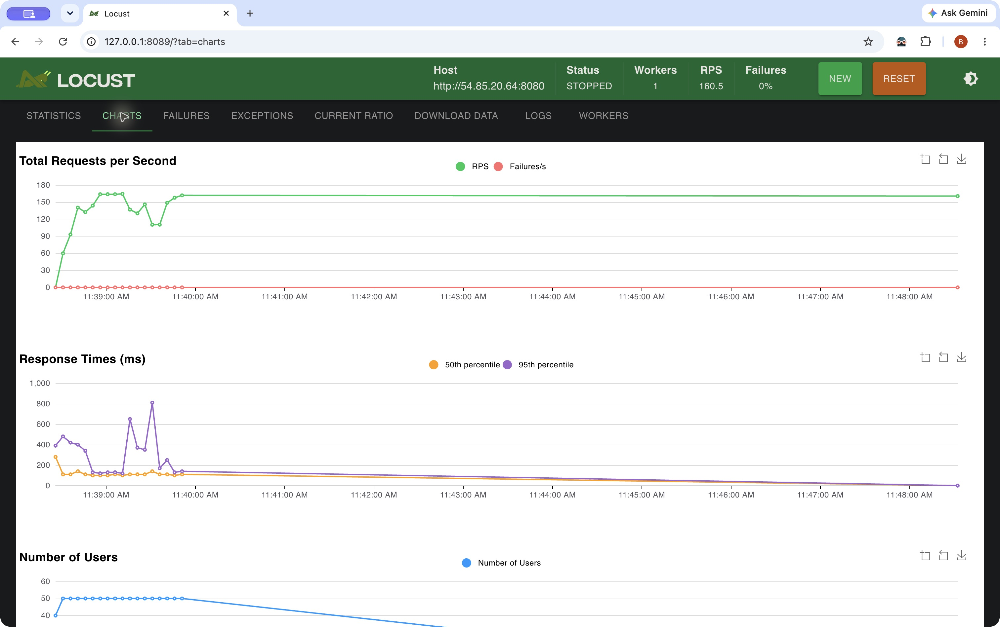
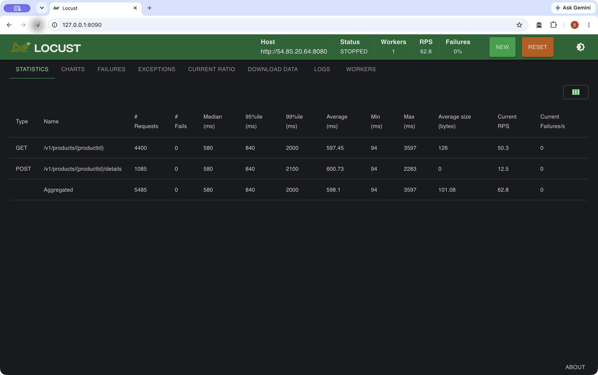
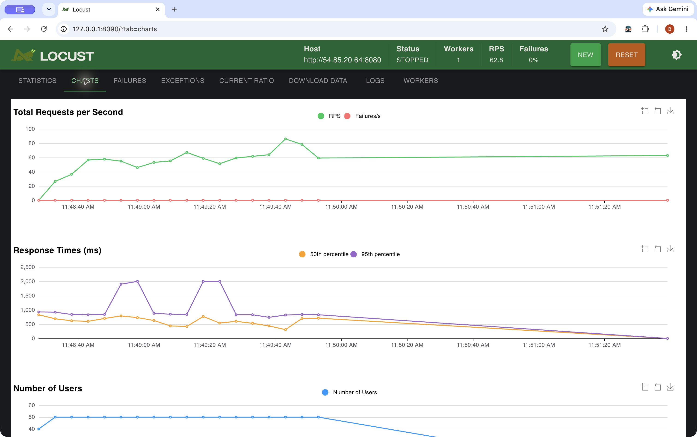
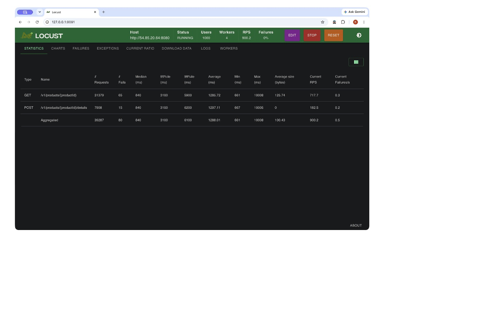
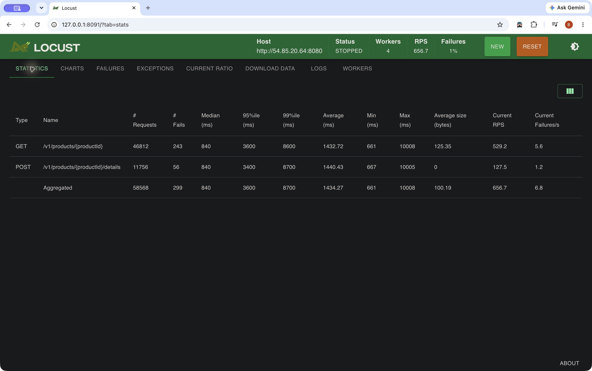
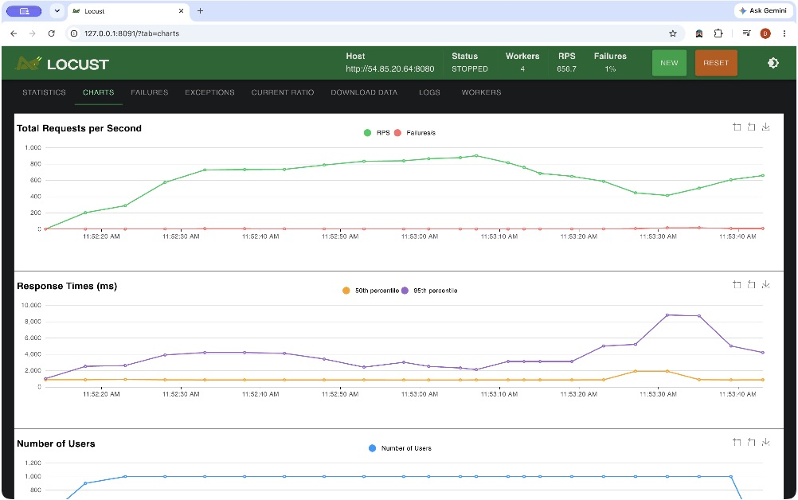

# Product API load tests

These tests use Locust 2.46.5, matching HW3, and target the Product API deployed on ECS. The screenshots are captures of the real Locust Statistics and Charts pages in Google Chrome. They are not reconstructed result pages.

## Workload

[locustfile.py](locustfile.py) defines `ProductHttpUser` and `ProductFastHttpUser` with the same `ProductTasks`. Run one class at a time. GET/POST weights are 4:1: a browsing-heavy catalog with repeated updates of one popular product. Each virtual user makes one request at a time; connections are reused by the client.

GET requests `/v1/products/12345` and checks both status 200 and the Product JSON. POST sends a valid replacement to `/v1/products/12345/details` and requires an empty 204. All replacements use the seeded values and SKU, so concurrent users do not cause artificial SKU conflicts or leave modified data. This tests a small, hot in-memory record; it does not represent a large catalog or a database workload. Invalid-input cases are tested separately by `scripts/check_api.py`.

The application API key comes from the ignored `../.env.aws`. Neither the settings manifests nor screenshots contain it. Both clients use a 5-second connection timeout and a 10-second read/network timeout. Transport failures retain Locust's original exception on future runs. The recorded runs below preceded that diagnostic refinement and reported transport failures as “got 0”; zero means no HTTP status was received, not an HTTP error response from Gin.

## Reproduce

Start Docker and Learner Lab, refresh AWS profile `learner-lab` if expired, and deploy the API using [the Terraform instructions](../terraform/README.md). Run these commands from the repository root. The wrapper discovers the current task address; `TARGET_URL` can override it and should contain the origin without `/v1`.

```bash
# HttpUser baseline: 50 users, one worker, 90 seconds including ramp-up.
RUN_ID=http-50 USER_CLASS=ProductHttpUser USERS=50 SPAWN_RATE=10 \
  RUN_TIME=90s WORKERS=1 WEB_PORT=8089 scripts/locust.sh up
# Open http://127.0.0.1:8089 in Chrome.
# After STOPPED, refresh Statistics to receive the final worker reports.
RUN_ID=http-50 scripts/locust.sh logs
RUN_ID=http-50 scripts/locust.sh down

# Run sequentially, with the same pacing and server resources.
RUN_ID=fast-50 USER_CLASS=ProductFastHttpUser USERS=50 SPAWN_RATE=10 \
  RUN_TIME=90s WORKERS=1 WEB_PORT=8090 scripts/locust.sh up
# Open http://127.0.0.1:8090 in Chrome and collect Statistics/Charts.
RUN_ID=fast-50 scripts/locust.sh down

# Higher-intensity run, explicitly authorized for this homework service.
RUN_ID=stress-1000 USER_CLASS=ProductFastHttpUser USERS=1000 SPAWN_RATE=100 \
  RUN_TIME=90s WORKERS=4 WAIT_MIN=0 WAIT_MAX=0 WEB_PORT=8091 \
  scripts/locust.sh up
# Open http://127.0.0.1:8091 in Chrome.
RUN_ID=stress-1000 scripts/locust.sh down
```

Each run stops load automatically after its configured duration, while its Web UI stays available until `down`. Keep runs sequential to avoid competing for the same task. Use a fresh `RUN_ID` for each new experiment so existing CSVs and settings remain attributable. `down` stops only that run's local Locust containers and network; it does not stop the AWS Product service. Web ports bind to loopback.

The wrapper writes a settings manifest before launch and mounts `../evidence/locust` for CSV statistics, full history, failures and exceptions. CSV history continues to receive rows while the Web UI remains alive after stopping; use the test time window rather than treating those idle rows as additional load duration. The native Charts screenshots also extend beyond the stopped run: flat RPS tails and latency lines falling toward zero after stopping are UI artifacts, not continued traffic or improved performance. All three configured load intervals were 90 seconds. UI “Current RPS” is a recent-window value, while the table below uses the CSV run-average Requests/s, including ramp-up. Refresh stopped pages before capturing final counts.

## Recorded results, 2026-10-16

The generator ran on the Mac through Docker Desktop and the target was one Fargate task in `us-east-1` with 0.25 vCPU and 512 MiB. Requests crossed the public internet. Each run lasted 90 seconds, with no controlled server fault injection.

| Run | Client | Users / workers | Spawn/s | Wait after a task | Requests | Failures | Average RPS | Mean ms | p95 ms | p99 ms |
| --- | --- | --- | ---: | --- | ---: | ---: | ---: | ---: | ---: | ---: |
| http-50 | HttpUser | 50 / 1 | 10 | 0.1–0.3 s | 12,831 | 0 | 142.54 | 142.31 | 350 | 770 |
| fast-50 | FastHttpUser | 50 / 1 | 10 | 0.1–0.3 s | 5,485 | 0 | 60.99 | 598.10 | 840 | 2,000 |
| stress-1000 | FastHttpUser | 1,000 / 4 | 100 | 0 s | 58,568 | 299 (0.51%) | 650.62 | 1,434.27 | 3,600 | 8,700 |

The CSVs, settings, console records and [summary.json](../evidence/locust/summary.json) preserve the evidence. These are single-run observations, not a statistically controlled ranking of clients. In this pair FastHttpUser was slower end to end. Its purpose is to reduce generator CPU using `geventhttpclient` instead of `requests`; it does not make each remote operation inherently faster. [Locust's performance documentation](https://docs.locust.io/en/2.46.5/increase-performance.html) explicitly makes this distinction. Public-network variation, connection behavior and run order were not isolated here; alternating repeated runs would be needed to attribute the difference.

The high-concurrency run increased throughput but also raised p95/p99 and produced 299 transport failures with no HTTP response (243 GET, 56 POST). The longest observed durations were about the configured 10-second network timeout. This establishes degradation in the tested end-to-end path; it does not identify the server's CPU capacity limit or the exact onset threshold between 50 and 1,000 users.

[CloudWatch ECS metrics](../evidence/locust/aws-ecs-metrics.json) over the collected window show a highest one-minute average CPU of 21.66%, a highest one-minute Maximum CPU of 32.42%, and maximum one-minute average memory utilization of 7.42%. CPU was not saturated in those samples. A [25-request server log excerpt during the stress run](../evidence/locust/stress-1000-server-excerpt.jsonl) has a maximum handler duration of 0.027 ms, much smaller than client latency. That excerpt is a small sample; its middleware timer also excludes network transit and waiting before entering Gin, so it cannot rule out other server-side queues or identify the network as the sole cause.

The [FastHttpUser generator snapshot](../evidence/locust/fast-50-docker-resources.jsonl) was collected during its baseline. The stress generator snapshot was collected after load ended and is [labeled accordingly](../evidence/locust/stress-1000-docker-resources-after.jsonl); it does not establish generator CPU headroom during stress. No CPU-overload warning was observed in the saved Locust run logs, which is also weaker evidence than continuous resource measurements.

## Actual Chrome screenshots

### HttpUser, 50 users





### FastHttpUser, 50 users





### FastHttpUser, 1,000 users







The stopped screenshot's header rounds the failure rate to 1%; the exact CSV fraction is 299/58,568 = 0.5105%. Do not substitute that rounded UI value for the calculated failure percentage. The completed [local Prometheus/Grafana experiment](../observability/README.md#evidence-and-screenshots) has its own idle-versus-load screenshots and logs from that same run; its native local image and Docker network differ from the public AWS measurements.

After collecting evidence, all local Locust containers and their Compose networks were removed. The [post-load cloud API checks](../evidence/locust/aws-post-load-http-checks.txt) passed and the seeded product was restored. The AWS Product service was left running for the next homework stage. A [two-second, single-user local diagnostic](../evidence/locust/local-transport-diagnostic.txt) separately verified that the revised workload preserves the original connection exception when no HTTP response is received; this diagnostic sent no traffic to AWS.
